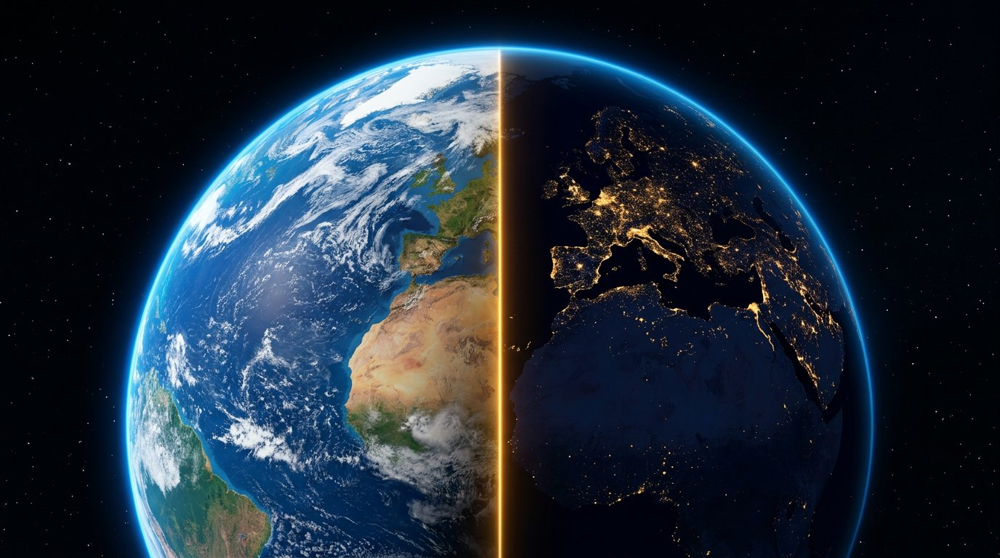

<div align="center">

# ZENITH

### A live planetary operations console in the browser.

Real orbits. Real quakes. Real space weather. ISS passes over Bihta. No API keys.

*The highest view of a living planet.*



</div>

---

**ZENITH** is an original cinematic Earth console. Public feeds only. MIT.

It is **not** a fork of anyone else’s globe, **not** a street-level spy tool, and it has **no CCTV**.

## Quick start

Needs **Node 18+**. No accounts. No keys.

```bash
git clone https://github.com/shubhamcore/zenith.git
cd zenith
npm install
npm run dev
```

Open **http://localhost:4177**.

| Command | What it does |
| --- | --- |
| `npm run dev` | Vite + proxies for OpenSky / CelesTrak |
| `npm run build` | Production bundle in `dist/` |
| `npm start` | Serve `dist/` with the same proxies (`PORT=4177`) |

## First five minutes

1. Wait for **on station**. The camera pushes in over Bihar.
2. Press **`G`** — Bihta beacon (25.561°N, 84.870°E).
3. Read the **ISS · BIHTA** ribbon: next pass in IST, max elevation. It turns **LIVE** when the station is actually up.
4. Press **`S`** — branded PNG snapshot (UTC + IST).
5. Watch **PULSE** — atmosphere glow follows live USGS seismic energy.

## What it does

- Photoreal Earth, gold terminator line, Moon with live phase
- SGP4 catalog (ISS + Tiangong), ISS ground track and comet trail
- Look-angles for ISS over Bihta (elevation, azimuth, range)
- USGS M2.5+ quakes, NOAA Kp / solar wind / aurora
- Upcoming launches (The Space Devs)
- Optional ADS-B air picture when run locally
- Auto briefing: dawn cities, next pass, space weather

## Keyboard

| Key | Action |
| --- | --- |
| `1` / `2` / `3` / `4` | Free / ISS / Terminator / Cinema |
| `G` | Fly to Bihta |
| `P` | Ride ISS if a Bihta pass is in progress |
| `S` | Snapshot PNG |
| `Q` / `L` | Next quake / launch |
| `C` / `A` | Clouds / aurora |
| `H` | Hide HUD |
| `R` | Reset view |
| `Space` | Pause cinema |
| `?` | Commands |

## Stack

- [Three.js](https://threejs.org/) — globe, atmosphere, stars
- [satellite.js](https://github.com/shashwatak/satellite-js) — SGP4 / look angles
- Vite — dev server and proxies
- Feeds: [DATA_SOURCES.md](DATA_SOURCES.md)

## GitHub Pages

`base` is `./`. Globe, quakes, space weather, aurora, launches, TLE snapshot, and Bihta passes work as static files. The **air picture** needs `npm run dev` or `npm start` (OpenSky has no CORS).

## Responsible use

Public telemetry only. Not a targeting system. Not affiliated with ISRO, NASA, or NOAA. No cameras.

## License

MIT. Textures: three.js examples (NASA Visible Earth lineage). Upstream data stays with its publishers.

---

Original code. Inspired by the *idea* of a live public-data globe — not a fork of any existing project.
